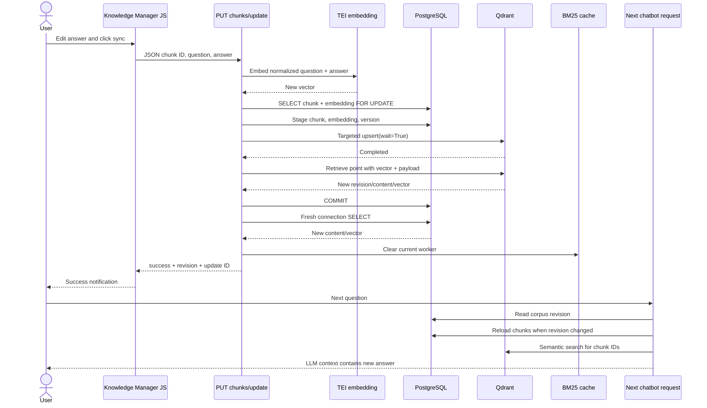

# Knowledge Update Lifecycle Audit

Audit date: 2026-08-18. Repository: `/root/projects/faq`.

## Result

Classification: **CODE_DEFECT_FOUND**.

The prior code updated PostgreSQL and Qdrant but had four correctness defects:

1. Qdrant upserts did not explicitly request completion.
2. no independent PostgreSQL or Qdrant read-after-write verification occurred;
3. the process-local BM25 corpus was not invalidated by update/revert; and
4. other workers had no way to discover an update, making stale answers
   nondeterministic in multi-worker production.

The repair adds acknowledged targeted Qdrant writes, both read-backs, rollback
and Qdrant compensation before commit, local invalidation, database-revision
based cross-worker cache refresh, row locking, stage timing, and correlation
logging. Production infrastructure is not available from this workspace, so
the environment is not verified and no claim of `CODE_VERIFIED_ENVIRONMENT_SUSPECTED`
is made.

## Exact frontend and API path

| Item | Finding |
|---|---|
| Form/control | The editable answer textarea `target-field-${chunk.id}` and button `sync-btn-${chunk.id}` in `static/js/kb_manager.js` |
| JavaScript | `executeAtomicPipelineSync(chunk, buttonInstance)` |
| HTTP method | `PUT` |
| Endpoint | `/knowledge-base/api/chunks/update` |
| Request | `{chunk_id, is_qa, question, answer, changed_by}` |
| Handler | `kb_manager.api_sync_chunk` |
| Coordinator | `new_architecture.knowledge_update.KnowledgeUpdateCoordinator.update` |
| Success | `{success, question_id, revision, knowledge_update_id, updated_stores, stage_durations_ms}` |
| Failure | non-2xx, safe message and correlation ID; detailed stage code is server-side |

Exact implementation locations in this audited tree are:

- frontend action and request: `static/js/kb_manager.js:416` and `:425`;
- FastAPI route/handler: `kb_manager.py:377` (`api_sync_chunk`);
- Qdrant acknowledgement adapter: `kb_manager.py:131-175`;
- PostgreSQL lock/update/version repository: `new_architecture/knowledge_update.py:152-266`;
- coordinator/order/verification/compensation: `new_architecture/knowledge_update.py:338-589`;
- authoritative retrieval SQL: `new_architecture/app/services/history/database.py:711-718`;
- cross-worker revision SQL: the same file at `:720-738`;
- revision check and BM25 rebuild: `utils/persian_hybrid_search.py:528-542`;
- retrieval-to-LLM-context handoff: `agent_graph.py:127-224` and
  `utils/RagSystem.py:210-264`.

The frontend disables the button, awaits `fetch`, checks `response.ok`, only
then displays success, and surfaces structured error messages. Its CSS, fonts,
and JavaScript are same-origin repository assets. No service worker,
`localStorage`, browser knowledge cache, or internet URL is used by this page.

## Sequence

## Current write order and semantics

The coordinator performs embedding before acquiring a row lock. PostgreSQL is
then staged, Qdrant is updated and confirmed, PostgreSQL commits, a new
connection verifies persistence, and local cache invalidation completes before
success. Qdrant update/retrieve and all PostgreSQL calls are synchronous. No
workflow step uses `BackgroundTasks`, `asyncio.create_task`, a thread-pool
fire-and-forget call, or sleep.

Exception behavior is stage-specific:

| Failure stage | API success? | PostgreSQL action | Qdrant action |
|---|---:|---|---|
| Embedding | No | No transaction | Unchanged |
| PostgreSQL lock/stage | No | Rollback | Unchanged |
| Qdrant write/confirmation | No | Rollback | Restore captured point/delete newly-created point |
| PostgreSQL commit response lost, fresh read proves old | No | Rollback attempt | Restore captured point |
| PostgreSQL commit response lost, fresh read proves new | May complete | Commit is proven | Keep confirmed new point |
| PostgreSQL commit outcome remains ambiguous | No | Repair required | Do not blindly overwrite the point |
| Fresh verification | No | Already committed; repair required | New point retained |
| Cache invalidation | No | Already committed; repair required | New point retained |

The operation is idempotent in final content but deliberately appends a version
entry and emits a new revision on each accepted call. Same-record concurrency
is deterministic last-lock-holder-wins.

## Source-of-truth proof

The live retrieval callback is built by `utils.rag_utils.chunk_fetcher_factory`
and calls `DatabaseManager.get_chunks_by_document_titles`, selecting
`chunks.content`. Qdrant semantic search asks for only `with_payload=["chunk_id"]`
and maps scores to the PostgreSQL chunk dictionary. Consequently:

- PostgreSQL contains authoritative answer text and metadata;
- Qdrant contains vectors plus a redundant payload, but retrieval uses its IDs
  and scores rather than its answer payload;
- MinIO is used while ingesting original documents and at application startup,
  not by the answering read path;
- filesystem chunks are read by ingestion scripts, not runtime retrieval;
- `embeddings.vector` is a durable relational copy, not queried by RAG search.

Because the embedded document is the entire normalized chunk, any answer edit
requires vector regeneration. An idempotent submission whose complete
embedding text is unchanged reuses the already-persisted vector.

## PostgreSQL audit

Related tables are `collections`, `documents`, `chunks`, `embeddings`,
`chunk_versions`, `knowledge_document_revisions`, `queries`, and `chat_sessions`. Selected datasource names are
request/session state; retrieval resolves them against `documents.title`.

The repaired query targets `chunks.id`, joins the one embedding row, locks both
rows, checks both update row counts, appends the version, and commits. A wholly
new connection then reads the row. Database connections are created per
operation; no stale ORM entity or read replica appears in this code path. The
repository does not use the unused SQLAlchemy pool in
`new_architecture/app/core/database.py`; production connection pooling remains
an operational concern.

Schema definitions are inconsistent across the old Alembic migration, ORM
models, and ingestion scripts (for example `document_chunks` versus `chunks`).
The running Knowledge Manager already depends on the ingestion-created
`chunks` schema. DevOps must compare the actual production schema rather than
assuming the old migration describes it.

## Qdrant audit

Point ID is the integer chunk ID. The payload includes chunk/document IDs,
chunk index, document title, complete content/text, and the new knowledge
revision. The vector represents normalized question plus answer (or the entire
raw chunk), so answer edits re-embed. Updates are one-point upserts; the
collection is never recreated. `wait=True` is explicit, followed by retrieve
and vector/payload comparison. This is required because Qdrant documents that
an un-awaited acknowledgment does not mean the point is already retrievable.

## MinIO and filesystem audit

MinIO stores the original uploaded document under a dated user/object key and
PostgreSQL `documents.file_path` records that key. Live edits do not rewrite the
source document because answering does not read it. Making MinIO a required
edit stage would add failure modes without improving answer consistency.

`data_insertion_chunks/DOCUMENTS/*`, generated chunks, NumPy, Parquet, and
similar artifacts are ignored. Paths used by ingestion derive from
`DATA_INSERTION_DIRECTORY`; the fallback in the reset/discovery tooling derives
from the repository path. The update handler contains no relative filesystem
write.

| Runtime-required path | Tracked by Git | Provisioned separately | Required for live edit/answer? |
|---|---:|---:|---:|
| `data_insertion_chunks/DOCUMENTS/.gitkeep` | Yes | No | No |
| Actual `DOCUMENTS/*` | No | Yes, for ingestion/reset | No |
| `CHUNKS/General_FAQ/.gitkeep` | Yes | No | No |
| Actual generated chunk files | No | Yes, for ingestion/reset | No |
| PostgreSQL knowledge rows | No | Yes | Yes |
| Qdrant collection/points | No | Yes | Yes |
| MinIO source objects | No | Yes | Startup/ingestion yes; live answer no |

## Cache and worker audit

The only cache in the verified retrieval path is
`PersianHybridSearch._bm25_cache`:

| Key | Value | Lifetime/scope | Invalidation |
|---|---|---|---|
| Sorted selected document-title tuple | Revision-tagged BM25 model, chunk IDs, chunk dictionary/text | Process lifetime, one app worker | Explicit local clear on mutation and automatic rebuild when `knowledge_document_revisions` changes |

`new_architecture/app/core/cache.py` provides Redis/memory helpers but is not
imported by the verified startup or retrieval path. Module globals such as
`rag_system` and `available_documents` are process-local services/listings, but
answers are not read from `available_documents`. Agent session state is stored
in PostgreSQL metadata and is not knowledge content.

With one, two, or four workers, the first retrieval after a committed change
checks the same PostgreSQL corpus revision. It cannot reuse a cache entry with
the previous revision. A request that began before the update committed may
finish using its pre-update snapshot; the guarantee starts when update success
is returned.

## Configuration and network audit

Update and retrieval share `POSTGRES_HOST`, `POSTGRES_PORT`, `POSTGRES_DB`,
`POSTGRES_USER`, `POSTGRES_PASSWORD`, and `QDRANT_COLLECTION` via the running
`main` module/client. Retrieval TEI uses `TEI_EMBED_URL`; update uses the same
search-engine embedding client. Ingestion has duplicated Config classes and
defaults, so destination equality must be verified in deployment.

`QDRANT_URL` is not used by the verified application runtime. `QDRANT_HOST` and
`QDRANT_PORT` are. `MINIO_ENDPOINT`/`MINIO_BUCKET` are startup/ingestion values.
`KNOWLEDGE_BASE_CSV` is not used by this workflow.

Endpoint addressing patterns:

| Layout | Correct pattern |
|---|---|
| All services on host | `localhost:<published-port>` is valid |
| FastAPI on host, data services in containers | host published ports or container host gateway |
| All on one Docker network | service DNS names, never `localhost` for another container |
| Separate servers | routable DNS/IP plus firewall/TLS configuration |

## Tests and evidence

`python3 -m unittest -v tests.test_knowledge_update_consistency
tests.test_revision_aware_cache` passed 15 isolated tests. They cover success,
fresh read, Qdrant verification, changed-vector generation, unchanged-vector
reuse, cache invalidation, independent worker caches, fresh coordinator, 20
sequential updates, concurrent updates, lost-commit-response resolution,
embedding/PostgreSQL/Qdrant/commit/
read-back/cache failure injection, compensation, and no false success.
`py_compile`, `node --check`, shell syntax validation, and `git diff --check`
passed.

The workspace Python lacks FastAPI, psycopg2, Qdrant, Parsivar, NumPy, pytest,
and live service configuration. Therefore no live PostgreSQL session, Qdrant
point, TEI embedding, MinIO object, HTTP endpoint, browser, two-worker server,
or actual LLM-context integration test was run. The synthetic tests prove the
coordinator policy, not the production topology. The acceptance criterion for
full application/environment verification remains open until the isolated
staging procedure in the operations document passes.

Cache policy microbenchmark (CPU-only, 100,000 hits, median of 7): direct old
cache access 90.2 ns; revision-aware in-process check 416.5 ns. The new policy
adds one PostgreSQL revision query per retrieval, which this synthetic number
does not measure. Staging must record before/after full request latency before
deployment.
